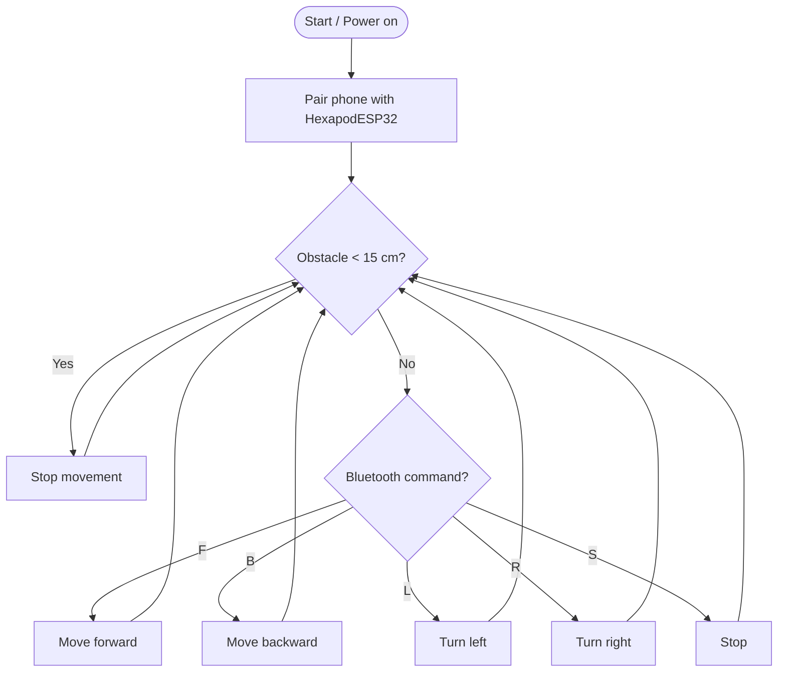

<div align="center">

# 🕷️ NeuroHexa — AI-Powered Hexapod

**A six-legged spider robot for autonomous and wireless-controlled navigation**


-00979D?logo=arduino&logoColor=white)


*Team Neuro-Hexa · EEE 2124 Electronics Laboratory · United International University · Spring 2025*

</div>

---

## 📖 Overview

Legged robots handle uneven terrain far better than wheeled ones. **NeuroHexa** is a low-cost, six-legged hexapod built around an **ESP32** and **12 MG90S servo motors** (two per leg). It walks with a **tripod gait**, avoids obstacles using an **HC-SR04 ultrasonic sensor**, and can be driven manually from a **custom Android app** over Bluetooth.

The project targets surveillance, exploration and research use cases, and is designed to be modular so new sensors and AI features can be added later.

## 🎯 Objectives

- Build a hexapod with smooth and stable movement
- Detect and avoid obstacles with an ultrasonic sensor
- Enable wireless manual control from a smartphone
- Power the robot safely from a 7.4 V LiPo battery
- Keep the platform cheap, scalable and easy to extend

## ✨ Features

| Feature | Description | Status |
|---|---|:---:|
| 🚶 Tripod-gait walking | Legs move in two alternating groups (1-4-5 and 2-3-6) for stable forward/backward motion | ✅ In firmware |
| 🔄 Turning | Left/right turns by driving the hips of each side in opposite directions | ✅ In firmware |
| 🛑 Obstacle stop | Robot halts when an object is closer than **15 cm** | ✅ In firmware |
| 📱 Bluetooth control | Android app built with MIT App Inventor sends single-character commands | ✅ In firmware |
| ⚖️ Self-balancing (BMI160 IMU) | Tilt detection with PID-like leg correction | 🧪 Designed, not in current sketch |
| 📡 Long-range RF (HC-12 / NRF24L01) | Alternative 433 MHz / 2.4 GHz remote control | 🧪 Designed, not in current sketch |
| 🧠 TinyML decision making | On-device navigation logic for autonomous mode | 🔮 Future work |

## 🧰 Hardware

| Component | Purpose |
|---|---|
| **ESP32** | Main controller, built-in Wi-Fi and Bluetooth |
| **MG90S servo ×12** | Leg actuation (hip + knee per leg) |
| **HC-SR04** | Obstacle detection (2–400 cm) |
| **BMI160 IMU** | Tilt / orientation sensing for balance |
| **HC-12 or NRF24L01** | Optional long-range wireless module |
| **7.4 V LiPo battery** | Main power source |
| **Buck converter (→ 5 V)** | Safe supply for servos |
| **3.3 V regulator / logic level shifter** | Supply and voltage compatibility for ESP32 and sensors |

> ⚡ **Power tip:** The LiPo battery (7.4 V) is stepped down to 5 V with a buck converter. Servos and control electronics are kept on separate rails to avoid brown-out resets when the servos draw current.

## 🔌 Pin Mapping

**Servos**

| Leg | Hip | Knee |
|:---:|:---:|:---:|
| 1 | GPIO 13 | GPIO 12 |
| 2 | GPIO 14 | GPIO 27 |
| 3 | GPIO 26 | GPIO 25 |
| 4 | GPIO 33 | GPIO 32 |
| 5 | GPIO 22 | GPIO 21 |
| 6 | GPIO 19 | GPIO 18 |

**Ultrasonic sensor:** `TRIG → GPIO 5` · `ECHO → GPIO 4`

## 🏗️ How It Works



### Bluetooth commands

| Command | Action |
|:---:|---|
| `F` | Move forward |
| `B` | Move backward |
| `L` | Turn left |
| `R` | Turn right |
| `S` | Stop (all servos to 90°) |

### Gait

All servos are calibrated to a neutral **90°** position. While walking forward, legs **1, 4, 5** lift (knee 60°), swing (hip 70°) and lower, then legs **2, 3, 6** do the same with the opposite hip angle (110°). This keeps three legs on the ground at all times for stability.

## 📱 Mobile Controller

The control app was built with **MIT App Inventor** and provides a simple D-pad: start, forward, backward, left, right, turn arrows and a big **STOP** button. It connects to the ESP32 over Bluetooth under the name **`HexapodESP32`**.

## 🚀 Getting Started

### Prerequisites
- Arduino IDE with the **ESP32 board package** installed
- The **ESP32Servo** library (provides the `Servo` API on ESP32)
- An Android phone with Bluetooth

### Setup
1. **Clone the repository**
   ```bash
   git clone https://github.com/<your-username>/<your-repo>.git
   ```
2. Open `hexapod.ino` in the Arduino IDE.
3. Select your ESP32 board and port, then **upload** the sketch.
4. Wire the servos and the HC-SR04 as shown in the pin mapping above.
5. Power the robot from the LiPo battery through the buck converter.
6. Pair your phone with **`HexapodESP32`** and open the controller app.
7. Press the arrows to walk, or **STOP** to halt.

> 💡 If `#include <Servo.h>` fails to compile for ESP32, include `<ESP32Servo.h>` instead.

## 📁 Repository Structure

```
.
├── hexapod.ino                  # ESP32 firmware
├── hexapod_spider_robot.jpeg    # Robot photo
├── 7-NeuroHexa.pdf              # Full project report
└── README.md
```

## ⚠️ Limitations

- Struggles on soft, muddy or sandy ground because of its pointed feet and weight
- Electronics are exposed, so there is a short-circuit risk near water
- Can slip on smooth surfaces (rubber foot pads would help)
- This is a prototype; several planned features (IMU balancing, RF module) are not in the current firmware

## 🔭 Future Improvements

- [ ] Integrate the BMI160 for real-time self-balancing
- [ ] Autonomous obstacle avoidance that re-routes instead of only stopping
- [ ] ESP32-CAM for live video and monitoring
- [ ] Sound and infrared sensors for search-and-rescue use
- [ ] Rubber foot pads and suction cups for grip and climbing
- [ ] Small mechanical arm for interacting with objects
- [ ] Cloud telemetry (MQTT) and voice control

## 👥 Team Neuro-Hexa (Group 07)

- Tanvir Azad
- Shariful Islam Labib
- Ibtida Ara
- A.H.M Tausifur Rahman
- Fiaz Hasan Samio

**Course:** Electronics Laboratory (EEE 2124), Section C
**Instructor:** Nabila Tasfiha Rahman, Lecturer, Dept. of CSE, United International University

## 🙏 Acknowledgement

We sincerely thank our course teacher, **Nabila Tasfiha Rahman**, for her guidance and support throughout this project.

---

<div align="center">⭐ If you like this project, give the repo a star!</div>
